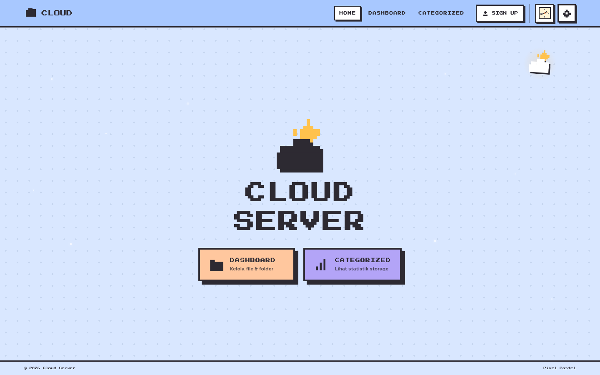

# Cloud Server — Pixel Pastel

Home cloud server pribadi dengan UI **pixel pastel** (minimalis, tanpa gradient norak),
backend Node.js **tanpa dependency eksternal**, dan tema yang bisa diganti.

**Live sekarang:** `https://cloud-server-production-ea2a.up.railway.app`



## Fitur

- Landing dengan logo matahari–awan, dot pattern, dan spotlight kursor
- 3 tema dengan karakter psikologis berbeda:
  - **Sky Pastel** — biru 214° (tenang dan terpercaya)
  - **Sakura Dusk** — rose 344° (hangat dan merawat), kelopak sakura bergugur
  - **Autumn Studio** — amber 32° (nyaman dan panen), daun gugur melayang
- Mode gelap dengan transisi *sapu lingkaran* yang imersif (wipe dari titik tombol)
- Bintang jatuh sesekali di mode gelap
- Auth (`/api/login`, `/api/register`) dengan cookie HttpOnly + isolasi per akun
- Upload biner sungguhan, unduh per file, dan ZIP yang mempertahankan struktur folder
- Mode seleksi lanjutan: Shift+klik rentang, pilih semua, unduh massal, hapus massal
- Categorized dengan donut storage, irisan per kategori, dan sorting nama/ukuran
- Dashboard dan Categorized fullscreen (tanpa scroll halaman; panel scroll internal)

## Menjalankan

```bash
git clone <repo>
cd portfolio
npm start          # = node server.js
# buka http://localhost:8000
```

Tanpa dependency — cukup Node.js ≥ 18.

### Akun awal

| Username | Password |
| --- | --- |
| `admin` | `pixel123` |
| `andra` | `pixel123` |
| `keluarga` | `pixel123` |

> Ganti password sebelum deploy — jalankan `node scripts/set-password.js <username> <password-baru>` lalu restart server.
> Maksimum 4 akun.

## Struktur

```
├── server.js          # backend: static + API + session + ZIP
├── index.html         # SPA: Landing, Dashboard, Categorized + modal
├── css/styles.css     # design system (token, 3 tema, animasi)
├── js/main.js         # router, API client, auth, file manager, chart
├── assets/            # kursor pixel
├── docs/              # STATUS.md + screenshot + mockup referensi
├── checkpoints/       # snapshot untuk rollback cepat
└── JOURNAL.md         # riwayat perubahan & keputusan desain
```

## Deploy

App di-deploy ke **Railway** (free plan, tanpa Docker, tanpa kartu kredit):

```bash
# Railway CLI: deploy dari direktori runtime
railway up -y --detach --new --name cloud-server
railway domain -p 8080   # → https://<service>.up.railway.app
```

## Screenshot

Lihat folder `docs/screenshots/`:

- Landing: `home-hero-sky.png`, `home-shooting-star.png`, `icon-sun-cloud.png`
- Tema: `psych-sky.png`, `psych-sakura.png`, `psych-autumn.png`, `autumn-leaves.png`, `sakura-petals.png`
- Mode: `mode-wipe-mid.png`, `mode-dark-after-wipe.png`
- Categorized: `categorized-slice-doc.png`, `categorized-slice-zip.png`, `categorized-split.png`

## Tes

Suite Playwright ada di luar repo (`/tmp/opencode/uitest`):

```bash
node test-rev12.js    # panel kategori, sorting, split chart
node test-rev11.js    # warna psikologis, transisi mode
node test-theme-stars.js
```

## Lisensi & catatan

Proyek pribadi untuk portofolio. Semua ikon digambar sendiri sebagai pixel art.
