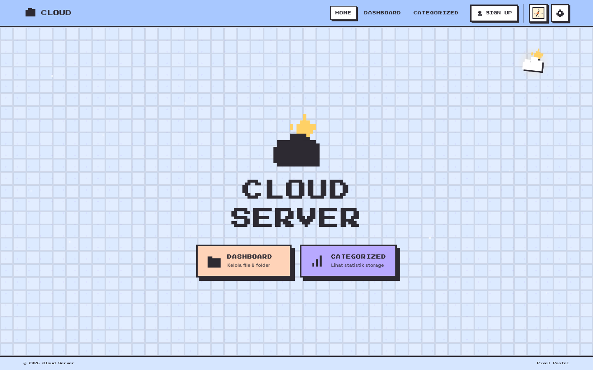

# ☁️ Cloud Server — Pixel Pastel

Home cloud server pribadi dengan UI **pixel pastel** (minimalis, tanpa gradient norak),
backend Node.js **tanpa dependency eksternal**, dan tema yang bisa diganti.



## ✨ Fitur

- **Landing** dengan logo matahari–awan, grid pixel, dan tombol bergaya game
- **3 tema** dengan karakter psikologis berbeda:
  - **Sky Pastel** — biru 214° (tenang & tepercaya)
  - **Sakura Dusk** — rose 344° (hangat & merawat), kelopak sakura berguguran
  - **Autumn Studio** — amber 32° (nyaman & panen), daun gugur melayang
- **Mode gelap** dengan transisi *sapu lingkaran* yang imersif (wipe dari titik tombol)
- **Bintang jatuh** sesekali di mode gelap
- **Auth** (`/api/login`, `/api/register`) dengan cookie HttpOnly + isolasi per akun
- **Upload** biner sungguhan, **unduh** per file, dan **ZIP** yang mempertahankan struktur folder
- **Mode seleksi lanjutan**: Shift+klik rentang, pilih semua, unduh massal, hapus massal
- **Categorized** dengan donut storage, **irisan per kategori**, dan sorting nama/ukuran
- **Dashboard & Categorized fullscreen** (tidak ada scroll halaman; panel scroll internal)

## 🚀 Menjalankan

```bash
git clone <repo>
cd portfolio
npm start          # = node server.js
# buka http://localhost:8000
```

Tanpa dependency — cukup Node.js ≥ 18.

### Akun awal

| Username | Password |
| --- | --- |
| `admin` | `pixel123` |
| `andra` | `pixel123` |
| `keluarga` | `pixel123` |

> ⚠️ **Ganti password sebelum deploy** — `node scripts/set-password.js <username> <password-baru>` lalu restart server.
> Maksimum 4 akun.

## 📁 Struktur

```
├── server.js          # backend: static + API + session + ZIP
├── index.html         # SPA: Landing, Dashboard, Categorized + modal
├── css/styles.css     # design system (token, 3 tema, animasi)
├── js/main.js         # router, API client, auth, file manager, chart
├── assets/            # kursor pixel
├── docs/              # STATUS.md + screenshot + mockup referensi
├── checkpoints/       # snapshot untuk rollback cepat
└── JOURNAL.md         # riwayat perubahan & keputusan desain
```

## 📸 Screenshot

Lihat [`docs/screenshots/`](docs/screenshots/) — landing tiap tema, dashboard, categorized,
transisi mode, dan mobile.

## 🧪 Tes

Suite Playwright ada di luar repo (`/tmp/opencode/uitest`):

```bash
node test-rev12.js   # panel kategori, sorting, split chart
node test-rev11.js   # warna psikologis, transisi mode
node test-theme-stars.js
```

## 📜 Lisensi & catatan

Proyek pribadi untuk portofolio. Semua ikon digambar sendiri sebagai pixel art.
